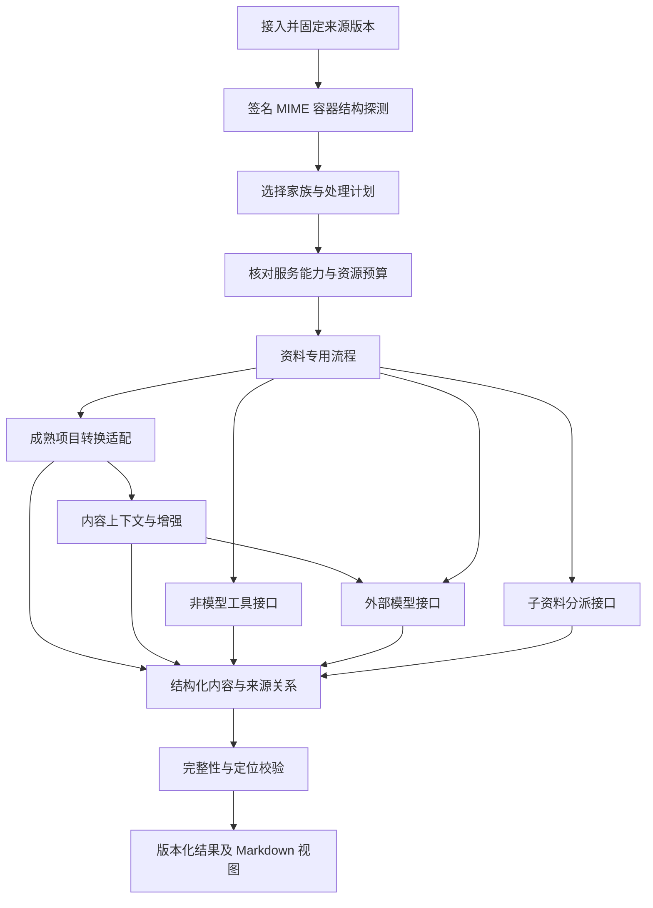

# 解析架构

当前基线是 **按资料类型组织流程，复用成熟项目的转换与内容增强能力，模型步骤接外部服务**。当前文本/JSON 与 DOCX/PPTX/XLSX/原生 PDF 的初始路径已实现，文档组按安装审计决定可用性。Python 3.12 环境及完整锁已验证；外部文本模型通过 core 协议、providers 适配和 apps 注入接入，当前开放独立 CLI/API，见 [模型接入](model-services.md)。原生解析 worker 保持离线。

## 目录与依赖

```text
src/knoa_parse/apps/
  api/                       API 接入、认证和任务查询；另提供 CLI 入口
  console/                   可选静态工作台及同源 API 装配；不被解析模块依赖
  worker/                    调度、注册解析器、注入工具及服务
src/knoa_parse/
  core/                      类型、接口、来源、任务、分派与结果规则
  parsers/                   按资料类型的独立流程
    text/ structured/ pdf/ document/ presentation/ spreadsheet/
    image/ audio/ video/ web/ ebook/ email/ archive/
    catalog.json             规划清单，不是运行时支持声明
  engines/                   成熟项目转换适配，优先验证 Docling
  enrichment/                有限的上下文选择与外部增强；不绑定 RAG 框架
  processors/                非模型工具适配
    media/ pdf/ office/ markup/ containers/
  providers/                 外部模型服务适配
    ocr/ asr/ vision/ document_analysis/ text_model/
contracts/                   版本化对外契约
evals/                       按资料家族组织的验收计划
docs/research/               有来源的调研与选型依据
```

| 层 | 允许的内部依赖 | 不允许的依赖 |
| --- | --- | --- |
| core | 无；以后可包含非业务基础依赖 | parsers、engines、enrichment、processors、providers 和主仓内部代码 |
| parsers/各家族 | core 的转换、增强、工具、Provider、子任务接口 | 上游框架、供应商 SDK、其他家族内部实现、具体适配器 |
| engines | core、经过检查的上游转换接口 | 主仓类型、具体 Provider、本地推理组件 |
| enrichment | core、有限的内容组织逻辑；通过接口调用工具与 Provider | LightRAG/图谱/索引实现、具体 Provider、本地模型 |
| processors | core 的工具接口、经过检查的非模型库/命令 | providers、parsers、本地推理组件 |
| providers | core 的 Provider 接口、外部服务客户端 | parsers、其他 Provider 私有实现、本地模型 |
| apps | 上述公开接口；负责具体实现的装配 | 业务算法、主仓权威数据库 |

接口属于 core，实现在 engines/enrichment/processors/providers，apps 注入具体实现。初期可以进程内调用，不要求把接口变成 HTTP 服务。运行时代码位于 src/knoa_parse，scripts/check.py 自动检查内部层次和资料家族导入边界。

家族隔离表示流程职责隔离，不要求独立重写 13 套解析引擎。Docling 等上游可被多个家族共享；图片、表格、公式等内容增强也跨格式复用。默认使用一个通用文档引擎；场景检测和网页正文使用按需专门模块。源码抽取必须证明收益，当前不预设搬运 RAG-Anything。选取依据见 [ADR 0004](adr/0004-selective-module-integration.md)。

## 执行过程



来源接入与内容解析分开：上传、URL 抓取和云盘连接属于接入边界；web 家族首先处理已保存的 HTML。原始字节、摘要和来源版本先固定。插件不能私自重新下载同一 URL 后混用内容版本。

## 家族路由与复合资料

详细格式清单见 [资料类型](formats.md)。不能仅凭扩展名分派：DOCX、PPTX、XLSX、EPUB 虽为 ZIP 容器，必须先检查容器清单，优先识别专有类型，再考虑通用 archive。MIME、签名与扩展名冲突时记录冲突并拒绝或选择经验证的格式，不静默按后缀处理。

视频独立规划音轨、字幕、视觉帧三条分支；普通文本只需解码、结构读取和偏移映射。两者共享 core，而不是复制任务框架。子任务输入通过 artifact 引用和派生关系传递，不直接传任意磁盘路径。

## 完整性与重试

- 计划先声明必需与可选能力。例如“完整视频理解”与“仅转录”是不同目标。
- 必需 Provider 未配置时，在计费前返回缺失能力；显式 best-effort 可得到带缺口的部分结果。
- 同一文档可以页级/音频分段级失败；保留失败单元与已完成产物，重试只处理缺失单元。
- 幂等范围建议包含租户作用域、来源摘要、处理选项、解析器版本、Provider 配置版本及单元标识。缓存不得跨授权边界，仅凭文件摘要不能授权复用。
- 自动回退必须属于允许的外部服务列表，并重新核对数据发送范围及剩余预算；不回退到本地推理。
- completed 仅说明请求的目标完成。因故遗漏的正文/页面/音轨不能作为正常完成；按计划跳过的可选图像说明可单独记 skipped。

## 数据边界

解析内容始终视为资料，不执行其中的脚本、宏、公式或模型提示。解包、XML、子进程和媒体解码需有字节、时长、页数、递归深度和超时限制。转换保存新的 artifact 与原文映射，不能把转换后的页码宣称为源 DOCX 固有页码。

Knoa Parse 不生成长期画像，不访问主仓数据库。主仓导入时核对结果与任务、来源和空间的绑定。

可选观测工作台只通过 HTTP API 操作同一任务服务，见 [ADR 0005](adr/0005-optional-observation-console.md)。解析器、引擎和 worker 不认识 UI，未上报的阶段、百分比、耗时、费用和心跳不因界面需要而伪造。

进一步阅读：[类型与模型边界](adr/0002-format-pipelines-and-remote-models.md)、[接入边界决策](adr/0004-selective-module-integration.md)、[实现方案](implementation-plan.md)、[处理流程](pipelines.md)、[外部能力接口](provider-interfaces.md)、[结果模型](result-model.md)、[横向调查](research/2026-10-15-module-selection.md)。
