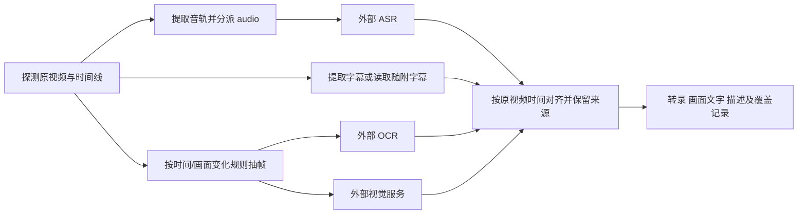

# 各类资料的处理流程

以下是开发蓝图，没有已实现的解析函数。每个家族的独立目录保存职责、候选和验收边界；工具、Provider 与子任务调度通过 core 接口注入。

## 文本与结构化资料

text：读取字节 → 确定编码/BOM → 解码 → 保留换行与字符映射 → 使用标准标记解析器识别段落/标题/代码 → 形成定位内容块。编码无法确定时不靠乱码“成功”；可由调用方指定编码。文本清洗产生另一个视图，不改变原始位置定义。

structured：JSON/JSONL/XML/YAML 解析 → 按记录或树节点组织 → 保留标量类型与节点路径。默认不调用模型；JSONL 某行损坏可在显式部分模式下跳过并报告行号，不能无声丢记录。

## PDF

探测加密/页面 → 页级原生文本、几何和图片提取 → 按目标评估是否需要增强 → 对需要处理的页渲染 → 外部 OCR 或 DocumentAnalysisProvider → 合并原生/OCR 结果并保留出处 → 页面/表格结构校验。

不能仅以“有少量文本”认定整页不是扫描内容。混合文档可有页眉文本和扫描正文；探测规则和阈值需在样例上校准。规则判断不引入本地分类模型。表格可优先试非模型几何提取，失败后用外部文档分析，或标记表格结构缺口。

OCR 和整文档分析通常是可选择的增强路线，不对相同页面无条件调用全部服务。保留 bbox 的单位、坐标原点、页旋转及图像变换；相同内容去重保留多个来源，不按重复字符串删正文。

## Word 文档

读取 DOCX 容器及关系 → 段落/标题/列表/表格/图片/可读取备注 → 内嵌资料分派 → 可选生成渲染副本用于版面/视觉增强 → 以文档结构位置为主组装结果。

旧 DOC/RTF/ODT 根据适配器能力走原生库或 LibreOffice 转换；保留输入与转换结果的摘要。分页取决于字体和渲染环境；不能把转换结果页数当作 DOCX 固有定位。

## PPT

读取演示文稿 → 按幻灯片提取形状、文本、表格、可读取的图表数据与备注 → 处理分组形状/嵌入内容 → 可选渲染单页 → 仅对图像型信息调用 OCR/视觉 → 按 slide/shape 与区域组装。

备注、正文、图片描述分别标记；不把备注误认为画面文本。图表优先保留实际数据和原始图像，不能把视觉估计数值替代底层数值。动画、SmartArt、阅读顺序无法完整恢复时报告缺口。

## Excel / CSV

读取工作簿/分隔符 → 工作表/行列/合并范围 → 原始值、类型、公式、已有缓存值与显示格式分别保留 → 按表或区域组装 → 图片/图表作为独立对象或子任务。

不执行宏、公式或外部链接。公式缓存缺失或过期风险必须显式表达，不能把空缓存当空单元格或计算结果。隐藏行、列、表默认保留标记，由调用选项决定纳入范围。大表使用流式或区域化策略，CSV 不先整体交给 LLM“读表”。

## 图片

读取帧/尺寸/EXIF 方向 → 必要时旋转/缩放并保存映射 → 根据目标选择 OCR 或视觉服务 → 归一化文字区域/视觉描述 → 映射回原图。

图中文字和视觉描述分别为识别结果与模型推断；图中不存在的概括不能冒充原文。多页 TIFF、动态图和 SVG 的执行/资源策略先明确再开放。

## 音频

ffprobe 探测流 → FFmpeg 标准化编码 → 按服务上限切分，记录偏移和重叠 → 外部 ASR → 时间戳/可选说话人归一化 → 去除分段边界重复 → 合并到原音轨时间线。

用固定窗口或非模型静音检测安排分段即可起步；需要神经 VAD/说话人分离时要求外部服务提供。片段时间加偏移才能回到原始音频，不假定不同服务的说话人 ID 可跨片段直接合并。

## 视频

字幕是否可信、是否覆盖目标语言需判断；有字幕不代表一定免 ASR。采样帧是选定策略下的覆盖，不能保证捕捉所有瞬间；记录采样区间和规则。可变帧率使用实际 presentation timestamp，不用帧号除固定 fps 推算全部定位。

“转录模式”在完成声音目标后可以成功；“音画模式”缺失必需的画面服务必须在执行前拒绝，或按显式 best-effort 返回部分结果。无音轨视频依然可以有视觉内容。音画矛盾保留两类证据，不让模型自动替用户裁定事实。

## 网页、电子书、邮件与压缩包

- web：保存页面快照 → DOM/正文提取 → 表格/链接/图片关系。动态浏览器采集是入口能力，不放进每个正文解析器；复现依赖快照和采集时间。
- ebook：读取 EPUB manifest/spine → 按阅读顺序读取章节 → 标记内容/图片分派 → 保留章节与内部资源路径；DRM 或未知格式返回不能处理。
- email：读取消息与 MIME 层级 → 选取/去重正文表示 → 附件分派 → 保留消息、正文与附件关联。HTML 正文不能当邮件原始字符串偏移。
- archive：验证条目路径与总预算 → 受限解包 → 对每个条目重新探测 → 分派子任务 → 聚合状态。限制压缩比、总大小、嵌套深度和条目数；禁越界路径及链接逃逸，不把未知 OOXML 当普通资料包散开解析。

## 统一失败规则

错误区分：不支持的格式、损坏/加密、资源超限、必需能力缺失、供应商限流、供应商永久错误、定位无效和内容不完整。每个错误携带作用单元、可重试性与稳定代码；供应商原文错误需脱敏。任务级状态由请求目标与各单元结果推导，不能简单“拿到任意文本就 completed”。
